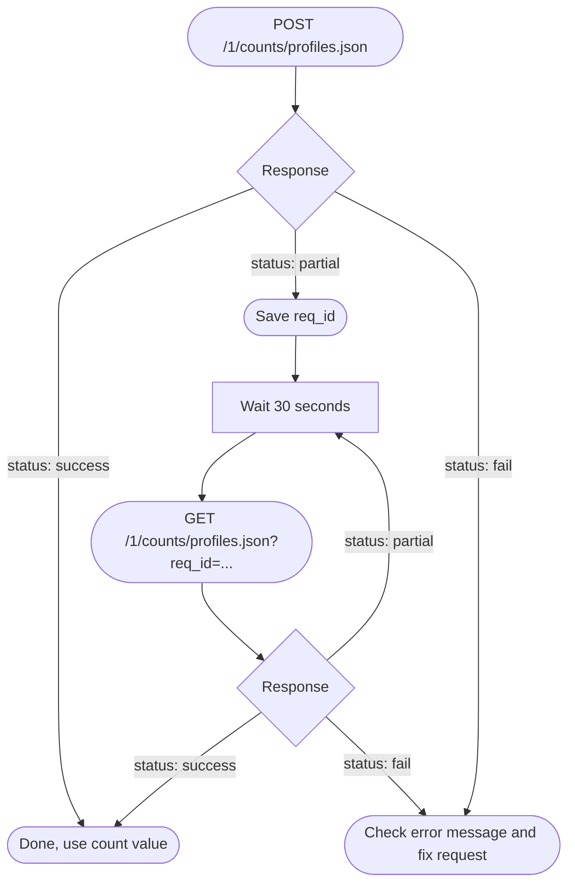

# Overview

This endpoint returns the total number of profiles that match an event query. The API can return the count immediately or a pending status that requires polling. Refer to [Response Handling](doc:get-profile-count-api#response-handling) below for both flows.

# Base URL

The following is a sample base URL:

`https://<region>.api.clevertap.com/1/counts/profiles.json`

For region-specific endpoints, refer to [Region](https://developer.clevertap.com/docs/common-api-components#region).

# HTTP Method

POST

This method applies to the initial request that submits the event query. The polling request used to check on a pending query uses a different method, covered in [Polling Endpoint](doc:get-profile-count-api#polling-endpoint).

# Headers

Refer to [Headers](https://developer.clevertap.com/docs/common-api-components#headers) for more details. The request requires the following headers.

* `X-CleverTap-Account-Id`
* `X-CleverTap-Passcode`
* `Content-Type: application/json`

# Body Parameters

The following table lists the body parameters:

<Table align={["left","left","left","left","left"]}>
  <thead>
    <tr>
      <th>
        Parameter
      </th>

      <th>
        Description
      </th>

      <th>
        Required
      </th>

      <th>
        Type
      </th>

      <th>
        Example Value
      </th>
    </tr>
  </thead>

  <tbody>
    <tr>
      <td>
        event_name
      </td>

      <td>
        The name of the event.
      </td>

      <td>
        required
      </td>

      <td>
        string
      </td>

      <td>
        "choseNewFavoriteFood"
      </td>
    </tr>

    <tr>
      <td>
        event_properties
      </td>

      <td>
        The event properties that you want to filter the results on.
      </td>

      <td>
        optional
      </td>

      <td>
        string key/value pairs
      </td>

      <td>
        ```json
        "event\_properties": [  
                {  
                    "name": "value",  
                    "operator": "contains",  
                    "value": "piz"  
                }  
            ]
        ```
      </td>
    </tr>

    <tr>
      <td>
        from
      </td>

      <td>
        Start of date range within which users should have performed the event you specified in event_name. Input values must be formatted as integers in the YYYYMMDD format.
      </td>

      <td>
        required
      </td>

      <td>
        int
      </td>

      <td>
        20150810
      </td>
    </tr>

    <tr>
      <td>
        to
      </td>

      <td>
        End of date range within which users should have performed the event you specified in event_name. Input values must be formatted as integers in the YYYYMMDD format.
      </td>

      <td>
        required
      </td>

      <td>
        int
      </td>

      <td>
        20151025
      </td>
    </tr>
  </tbody>
</Table>

The following is a sample payload.

```json
{
    "event_name": "choseNewFavoriteFood",
    "event_properties": [
        {
            "name": "value",
            "operator": "contains",
            "value": "piz"
        }
    ],
    "from": 20150810,
    "to": 20151025
}
```

# Example Request

The following is a sample request:

```curl
curl -X POST -d '{"event_name":"choseNewFavoriteFood","event_properties":[{"name":"value","operator":"contains","value":"piz"}],"from":20150810,"to":20151025}' "https://<region>.api.clevertap.com/1/counts/profiles.json" \
-H "X-CleverTap-Account-Id: ACCOUNT_ID" \
-H "X-CleverTap-Passcode: PASSCODE" \
-H "Content-Type: application/json"
```
```ruby
require 'net/http'
require 'uri'
require 'json'

uri = URI.parse("https://<region>.api.clevertap.com/1/counts/profiles.json")
request = Net::HTTP::Post.new(uri)
request.content_type = "application/json"
request["X-Clevertap-Account-Id"] = "ACCOUNT_ID"
request["X-Clevertap-Passcode"] = "PASSCODE"
request.body = JSON.dump({
  "event_name" => "choseNewFavoriteFood",
  "event_properties" => [
    {
      "name" => "value",
      "operator" => "contains",
      "value" => "piz"
    }
  ],
  "from" => 20150810,
  "to" => 20151025
})

req_options = {
  use_ssl: uri.scheme == "https",
}

response = Net::HTTP.start(uri.hostname, uri.port, req_options) do |http|
  http.request(request)
end
```
```python
import requests

headers = {
    'X-CleverTap-Account-Id': 'ACCOUNT_ID',
    'X-CleverTap-Passcode': 'PASSCODE',
    'Content-Type': 'application/json',
}

data = '{"event_name":"choseNewFavoriteFood","event_properties":[{"name":"value","operator":"contains","value":"piz"}],"from":20150810,"to":20151025}'

response = requests.post('https://<region>.api.clevertap.com/1/counts/profiles.json', headers=headers, data=data)
```
```php
<?php
include('vendor/rmccue/requests/library/Requests.php');
Requests::register_autoloader();
$headers = array(
    'X-CleverTap-Account-Id' => 'ACCOUNT_ID',
    'X-CleverTap-Passcode' => 'PASSCODE',
    'Content-Type' => 'application/json'
);
$data = '{"event_name":"choseNewFavoriteFood","event_properties":[{"name":"value","operator":"contains","value":"piz"}],"from":20150810,"to":20151025}';
$response = Requests::post('https://<region>.api.clevertap.com/1/counts/profiles.json', $headers, $data);
```
```javascript Node.js
var request = require('request');

var headers = {
    'X-CleverTap-Account-Id': 'ACCOUNT_ID',
    'X-CleverTap-Passcode': 'PASSCODE',
    'Content-Type': 'application/json'
};

var dataString = '{"event_name":"choseNewFavoriteFood","event_properties":[{"name":"value","operator":"contains","value":"piz"}],"from":20150810,"to":20151025}';

var options = {
    url: 'https://<region>.api.clevertap.com/1/counts/profiles.json',
    method: 'POST',
    headers: headers,
    body: dataString
};

function callback(error, response, body) {
    if (!error && response.statusCode == 200) {
        console.log(body);
    }
}

request(options, callback);
```
```go
type Payload struct {
	EventName       string `json:"event_name"`
	EventProperties []struct {
		Name     string `json:"name"`
		Operator string `json:"operator"`
		Value    string `json:"value"`
	} `json:"event_properties"`
	From int `json:"from"`
	To   int `json:"to"`
}

data := Payload{
// fill struct
}
payloadBytes, err := json.Marshal(data)
if err != nil {
	// handle err
}
body := bytes.NewReader(payloadBytes)

req, err := http.NewRequest("POST", "https://<region>.api.clevertap.com/1/counts/profiles.json", body)
if err != nil {
	// handle err
}
req.Header.Set("X-Clevertap-Account-Id", "ACCOUNT_ID")
req.Header.Set("X-Clevertap-Passcode", "PASSCODE")
req.Header.Set("Content-Type", "application/json")

resp, err := http.DefaultClient.Do(req)
if err != nil {
	// handle err
}
defer resp.Body.Close()
```

# Response Handling

The response status determines what action you take next. The API returns one of three statuses: success, partial, or fail. The following diagram shows the full decision flow, including the polling loop:



## Synchronous Response

If the query completes immediately, the status is success or failure.

If the status is success, the response includes a count key with an int value for the specified query.

```json
{
  "status": "success",
  "count": 7138
}
```

If the status is fail, the response includes an error key with a string value and an HTTP status code. If the request body is missing or not valid JSON, the API returns HTTP 400 with the error "Payload is mandatory." A missing or incorrect Content-Type header does not, on its own, cause a failure; the API reads the request body directly regardless of the declared Content-Type.

## Asynchronous Response (Polling Required)

If the status is partial, the query has not finished processing in our system. The response includes a req_id key with a long int value, which you use to poll for the result.

```json
{
  "req_id": 384649162721759,
  "status": "partial"
}
```

After the query completes, polling returns either a success response with the count or a failure response with an error string and an HTTP status code.

### Polling Endpoint

Once you receive a req_id, you poll a separate endpoint to retrieve the final result. This request uses the GET method, unlike the initial POST request, and passes req_id as a query parameter.

```
GET https://api.clevertap.com/1/counts/profiles.json?req_id=<your_request_id_here>
```

Wait 30 seconds between polling requests.

<Callout icon="📘" theme="info">
  #### Region

  The following is an example base URL from the account in the India region. To know the API endpoint for your account, refer to [Region](https://developer.clevertap.com/docs/common-api-components#region).
</Callout>

For more information on the request limit, refer to [API Request Limit](doc:api-request-limit). To understand common queries and concerns about CleverTap APIs, refer to [API FAQs](doc:api-faqs).

# Error Codes

The following table lists the error codes returned by this API:

| HTTP Status | Code or Status | Error                                                   | Description                                                                                                  | Example Error Response                                                               |
| ----------- | -------------- | ------------------------------------------------------- | ------------------------------------------------------------------------------------------------------------ | ------------------------------------------------------------------------------------ |
| 400         | fail           | Account credentials missing                             | Account-Id or Passcode header is present, but cannot be parsed                                               | \{"status":"fail","error":"Account credentials missing"}                             |
| 400         | fail           | Payload is mandatory                                    | Request body is absent, empty, or not valid JSON                                                             | \{"status":"fail","error":"Payload is mandatory"}                                    |
| 400         | fail           | (query validation error string)                         | Body is valid JSON, but the query fails semantic validation; the exact validation error is returned verbatim | \{"status":"fail","error":"[unknown event property]"}                                |
| 400         | fail           | Invalid request ID                                      | Polling req_id has expired or is not found                                                                   | \{"status":"fail","error":"Invalid request ID"}                                      |
| 400         | fail           | Invalid query                                           | Polling request has no req_id, or an unhandled exception occurred during processing                          | \{"status":"fail","error":"Invalid query"}                                           |
| 400         | fail           | Error Processing, Please try again later                | Async processing failure (for example, async context error mid-flight)                                       | \{"status":"fail","error":"Error Processing, Please try again later"}                |
| 401         | fail           | Invalid Credentials                                     | Account-Id or Passcode header value is incorrect                                                             | \{"status":"fail","error":"Invalid Credentials"}                                     |
| 429         | fail           | Too many concurrent requests                            | Per-account concurrency limit exceeded (infrastructure throttle)                                             | \{"status":"fail","error":"Too many concurrent requests"}                            |
| 429         | fail           | Invalid query blocking this because of too many retries | Request blocked by an internal per-account rate-limit control (LaunchDarkly-managed)                         | \{"status":"fail","error":"Invalid query blocking this because of too many retries"} |
| 500         | fail           | Server error                                            | Event Store returned an internal server error                                                                | \{"status":"fail","error":"Server error"}                                            |
| 503         | fail           | 12-digit account ID mandatory.                          | Account-Id header is missing from the request                                                                | \{"status":"fail","error":"12 digit account ID mandatory."}                          |
| 503         | fail           | Please come back later                                  | Global request limit exceeded, or async processing timed out                                                 | \{"status":"fail","error":"Please come back later"}                                  |
| 503         | fail           | System under maintenance. Please retry later            | Event Store is unreachable or reports itself as down                                                         | \{"status":"fail","error":"System under maintenance. Please retry later."}           |
